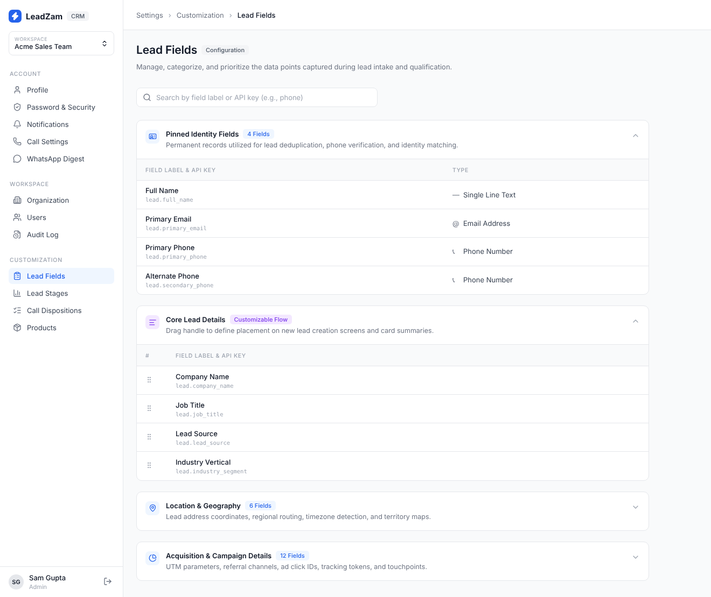
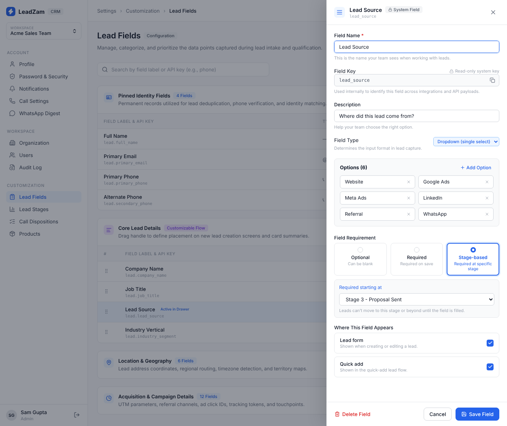
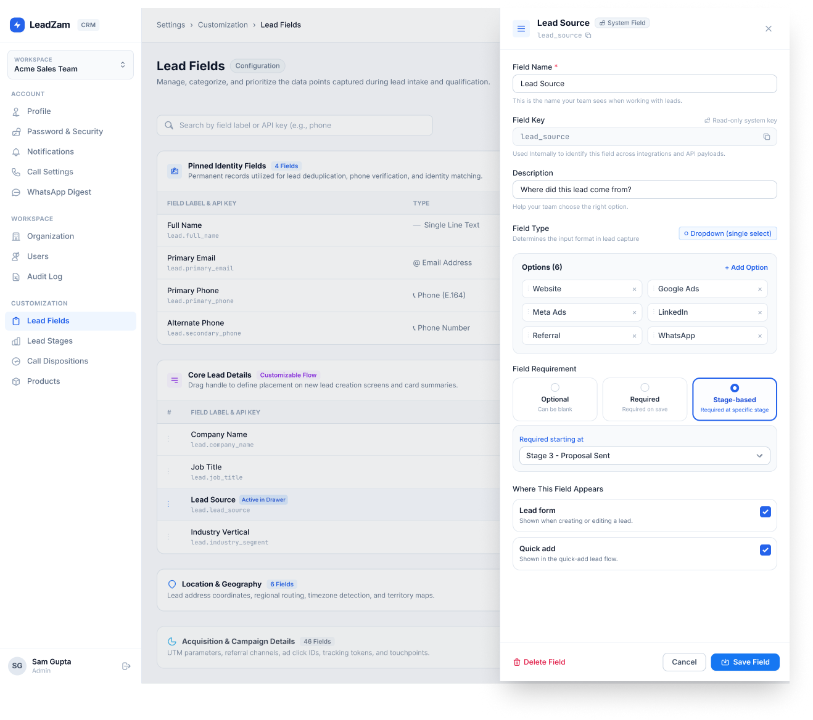
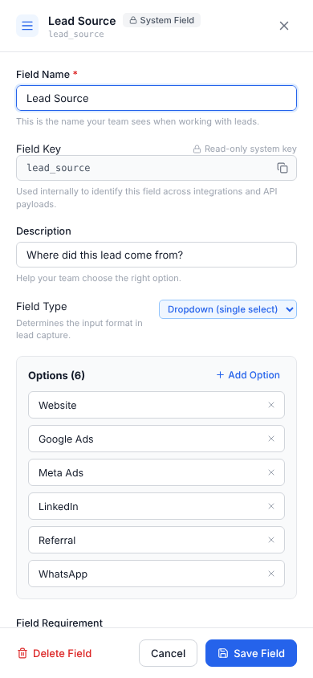
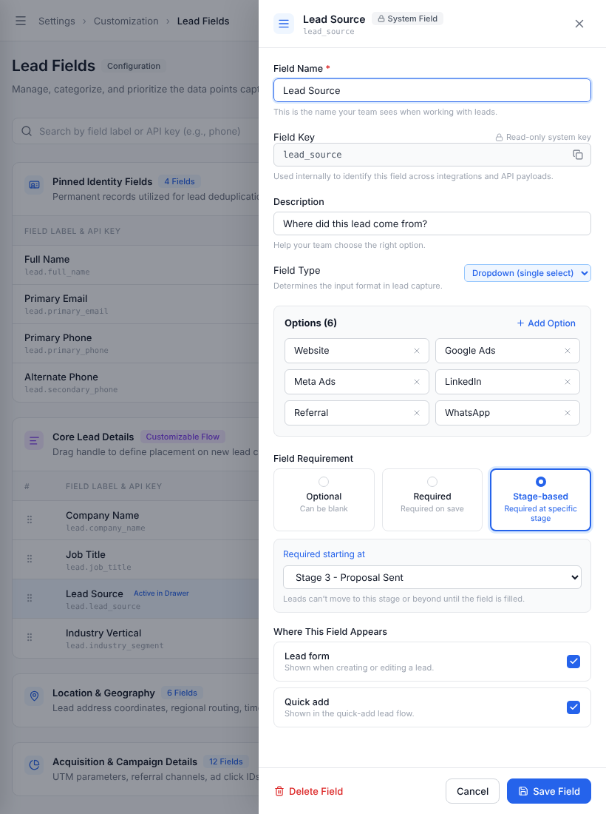
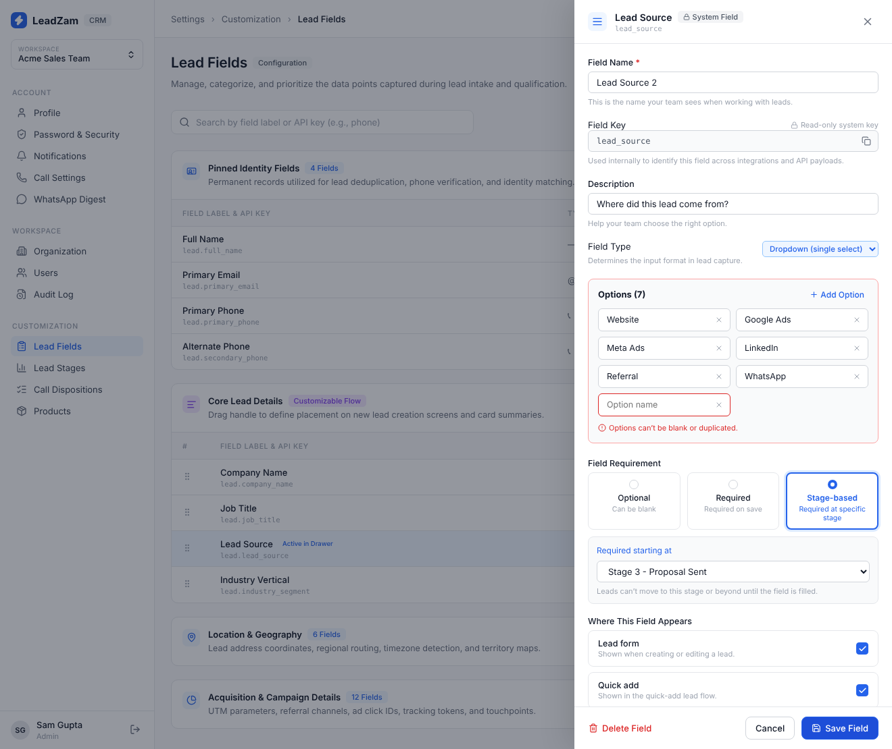

# LeadZam – Lead Fields Management

A focused UI/UX redesign and frontend implementation of the Lead Fields Management experience for LeadZam CRM, built with React, TypeScript, and Vite.

The project focuses on simplifying field configuration through better organization, contextual editing, clear requirement settings, and safer administrative actions.

## Project Links

| Resource | Link |
|---|---|
| Live Preview | [View Live Application](https://wondrous-croissant-444e65.netlify.app/) |
| GitHub Repository | [LeadZam – GitHub](https://github.com/samgupta221/LeadZam) |
| Figma Design | [View Figma Redesign](https://www.figma.com/design/Cv612QhH9zrrgjXqSpM9vH/LeadZam?node-id=0-1) |

## Project Overview

This project was developed as part of the **LeadZam UI/UX & Frontend Intern Practical Assessment**.

The selected area of improvement is the Lead Fields Management workflow, where CRM administrators configure field names, API keys, field types, dropdown options, requirement rules, and field visibility.

Managing these settings involves multiple decisions that can affect lead capture and data consistency.

The proposed redesign introduces a structured field management page and a contextual Edit Field drawer to make configuration easier to understand while preserving the surrounding page context.

The frontend prototype uses local mock data and does not require access to LeadZam's production backend.

## Problem Statement

Field configuration is a multi-step administrative task involving several settings.

Incorrect requirement configurations may affect lead capture, while changes to integration-dependent fields may introduce data-related issues.

The redesign aims to:

- Improve the organization of lead fields.
- Make field configuration easier to understand.
- Keep system-generated API keys read-only.
- Simplify field requirement selection.
- Preserve page context during field editing.
- Provide clear feedback for important actions.
- Make destructive actions safer through confirmation.

## Key Features

### 1. Lead Fields Management

- Organized field sections for easier navigation.
- Pinned Identity Fields.
- Core Lead Details.
- Location & Geography.
- Acquisition & Campaign Details.
- Search fields by label or API key.

### 2. Edit Field Drawer

- Edit field names and descriptions.
- Display read-only system field keys.
- Configure field types.
- Add and remove dropdown options.
- Manage field requirements:
  - Optional
  - Required
  - Stage-based
- Select the required starting stage.
- Configure field visibility in Lead Form and Quick Add.

### 3. Interactive Functionality

- Open and close the Edit Field drawer.
- Update field configuration.
- Add and remove dropdown options.
- Toggle field requirement settings.
- Show the stage selector when Stage-based is selected.
- Toggle field visibility.
- Save changes with success feedback.
- Cancel changes and restore previous values.
- Delete fields with a confirmation step.
- Display relevant validation and feedback states.

### 4. Responsive Layout

- Desktop layout.
- Tablet layout.
- Mobile-friendly interface.
- Responsive drawer and form arrangement.

## Screenshots

### Desktop – Default State



### Desktop – Edit Field Drawer



### Figma Design Reference



### Mobile View



### Tablet View



### Validation State



## Tech Stack

| Technology | Purpose |
|---|---|
| React | Component-based frontend development |
| TypeScript | Type safety and maintainable code |
| Vite | Development server and build tooling |
| CSS | Styling and responsive layouts |
| HTML5 | Application structure |
| Lucide Icons | Interface icons |

## Project Structure

```text
LeadZam/
│
├── docs/
│   ├── screenshots/
│   │   ├── desktop-default.png
│   │   ├── desktop-drawer-open.png
│   │   ├── figma-reference.png
│   │   ├── mobile.png
│   │   ├── tablet.png
│   │   └── validation-state.png
│   │
│   ├── AUDIT.md
│   └── DEMO_SCRIPT.md
│
├── public/
│
├── src/
│   ├── components/
│   ├── App.tsx
│   └── ...
│
├── index.html
├── package.json
├── package-lock.json
├── tsconfig.json
├── vite.config.ts
├── .gitignore
└── README.md
```

## Getting Started

Follow these instructions to run the project locally.

### Prerequisites

- Node.js
- npm
- Git

### 1. Clone the repository

```bash
git clone https://github.com/samgupta221/LeadZam.git
```

### 2. Navigate to the project directory

```bash
cd LeadZam
```

### 3. Install dependencies

```bash
npm install
```

### 4. Start the development server

```bash
npm run dev
```

Open the local URL displayed in the terminal by Vite.

### 5. Create a production build

```bash
npm run build
```

The generated production files will be available in the `dist/` directory.

## UI/UX Design Decisions

The redesign focuses on simplifying the field management workflow without changing the overall CRM structure.

### 1. Grouped Field Organization

Fields are arranged into meaningful categories to improve scanning and navigation.

### 2. Contextual Editing

The Edit Field drawer allows administrators to modify fields without navigating away from the main field list.

### 3. Read-only System Keys

System-generated API keys remain visible but cannot be accidentally modified.

### 4. Explicit Requirement Choices

Optional, Required, and Stage-based requirements are presented as three distinct choices.

### 5. Conditional Stage Selection

The required starting stage selector appears when Stage-based is selected.

### 6. Safer Administrative Actions

Delete and Save actions have separate visual emphasis, with a confirmation step for deletion.

## UI/UX Audit

The project includes a focused UI/UX audit with four prioritized findings.

| Finding | Priority |
|---|---|
| Complex field configuration workflow | High |
| Self-serve trial/signup discoverability | Medium |
| Audience positioning differences | Medium |
| Visibility of customization features | Low |

The field configuration workflow was selected for deeper improvement because of its potential impact on lead capture, data consistency, and integrations.

**Detailed Audit:** [View AUDIT.md](docs/AUDIT.md)

**Important evidence limitation:** The authenticated LeadZam application was not accessed. The selected problem is based on task analysis and the supplied assignment brief, not first-hand observation of the live application. Marketing-site observations were based on text content only.

## Scope and Limitations

This project is a focused frontend prototype, not a complete CRM application.

- Uses local mock data.
- Does not include production backend or database integration.
- Does not implement real authentication or authorization.
- The Acquisition & Campaign Details section uses 12 mock fields rather than reproducing all 46 fields shown in the design reference.
- Drag-and-drop field reordering is not implemented.
- The complete Add Field workflow is outside the current scope.
- Changes are managed through frontend state and are not persisted to a production database.

## Future Improvements

Potential improvements for a future iteration:

- Drag-and-drop field reordering with keyboard accessibility.
- Complete Add Field workflow.
- Unsaved-changes confirmation.
- Data-impact warnings before changing existing field types.
- Backend API integration.
- Component-level and interaction tests.
- Additional accessibility and usability testing.

## AI Usage Notes

**AI Tool Used:** Claude

AI-assisted development was used to support the assignment workflow.

### How AI Helped

- Assisted with understanding the assignment requirements.
- Supported UI/UX audit drafting and prioritization.
- Helped translate the Figma design into React and TypeScript components.
- Assisted with implementation planning and documentation.

### Review and Verification

AI-generated code and recommendations were reviewed against the supplied Figma design and assignment requirements.

The production build was verified locally using:

```bash
npm run build
```

The build completed successfully.

The implementation scope, visual references, and documented limitations were also reviewed.

The authenticated production application was not accessed, so no live-app observations were claimed.

## Assignment Deliverables

| Deliverable | Location |
|---|---|
| UI/UX Audit | `docs/AUDIT.md` |
| Demo Walkthrough Script | `docs/DEMO_SCRIPT.md` |
| Design Screenshots | `docs/screenshots/` |
| Figma Redesign | [Figma Design](https://www.figma.com/design/Cv612QhH9zrrgjXqSpM9vH/LeadZam?node-id=0-1) |
| Frontend Implementation | This repository |
| Live Preview | [Netlify Application](https://wondrous-croissant-444e65.netlify.app/) |

---
